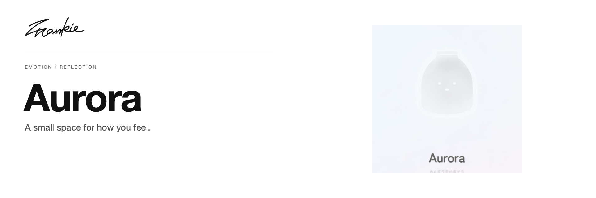

# Aurora

[English](README.md) · [简体中文](README.zh-CN.md)

Give today’s feelings a place in an aurora bottle, then sort through them with conversation, a diary and notes.

[Introduction](https://songhaifan.github.io/frankie-emotion-diary/) · [Guide (中文)](docs/guide.md) · [Run locally](#run-locally)

## What it does

- Record how you feel and talk with Aurora beside the aurora bottle.
- Look back on your entries through the diary and emotion calendar.
- Keep small things that matter as notes on the wall behind the bottle.

## Run locally

```sh
npm ci
npm run dev
```

Open the URL printed by Vite. AI conversation uses the server-side `OPENAI_API_KEY` on Vercel (or in `.env.local` for local development). Account features require the Firebase project and authorized domains configured through `services/firebase.ts`.

## Before you start

You can start through the guest entrance. Firebase provides Google sign-in and account data. AI conversation runs through the same-origin `/api/chat` endpoint using OpenAI. The API key stays on the server and is never included in the browser bundle.

## For developers

```sh
npm run build
```

[AI setup](docs/ai-service.md) · [Project guide (中文)](docs/guide.md) · [Artwork](docs/readme/README.md)

---

Made by [Songhai Fan](https://github.com/SonghaiFan) · A Frankie project
