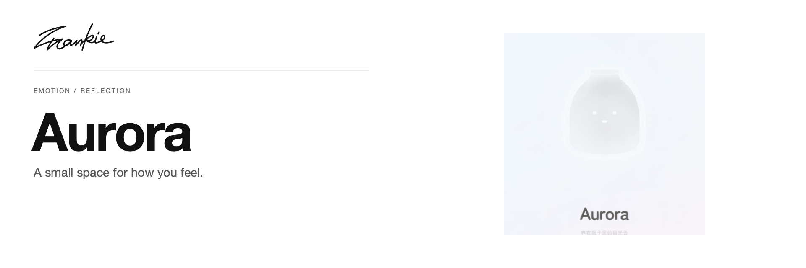

# Aurora

[English](README.md) · [简体中文](README.zh-CN.md)

把今天的情绪交给一只极光瓶，在对话、日记和便签里慢慢整理。

[介绍页](https://songhaifan.github.io/frankie-emotion-diary/zh/) · [项目指南](docs/guide.md) · [本地运行](#本地运行)

## 可以做什么

- 在极光瓶旁记录此刻的情绪，与 Aurora 对话。
- 用日记和情绪日历回看自己的记录。
- 把想留下的小事写成便签，贴在身后的墙上。

## 本地运行

```sh
npm ci
npm run dev
```

打开 Vite 输出的地址。AI 对话使用 Vercel 服务端的 `OPENAI_API_KEY`（本地开发时在 `.env.local` 中设置）；账户功能需要配置 `services/firebase.ts` 对应的 Firebase 项目和授权域名。

## 开始之前

可以通过访客入口开始体验。Google 登录和账户数据由 Firebase 提供。AI 对话通过同源 `/api/chat` 接口调用 OpenAI，key 仅保存在服务端，不进入浏览器构建产物。

## 开发说明

```sh
npm run build
```

[AI 配置](docs/ai-service.md) · [项目指南](docs/guide.md) · [Banner 维护](docs/readme/README.md)

---

由 [Songhai Fan](https://github.com/SonghaiFan) 制作 · Frankie 系列项目
